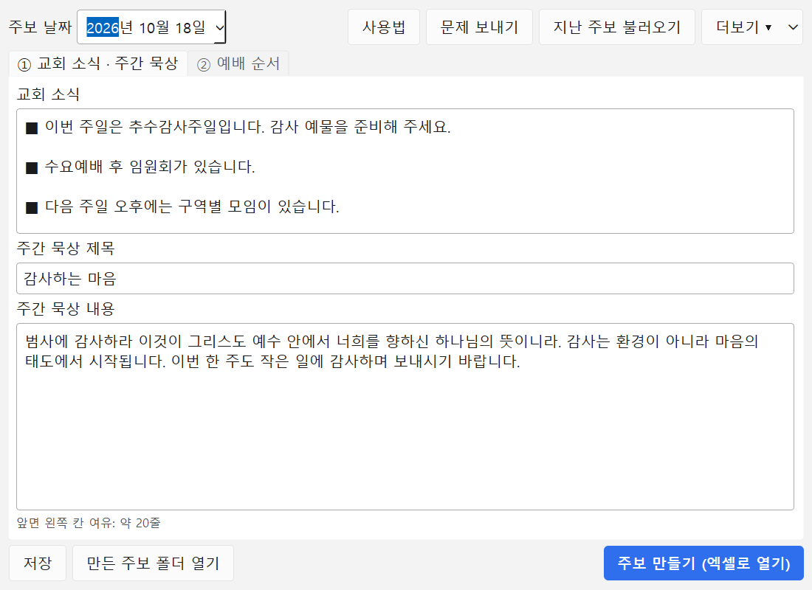
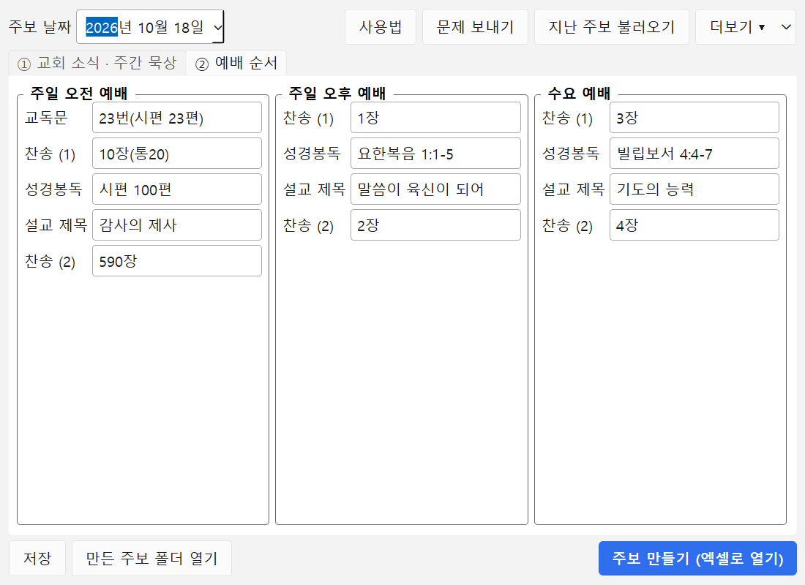
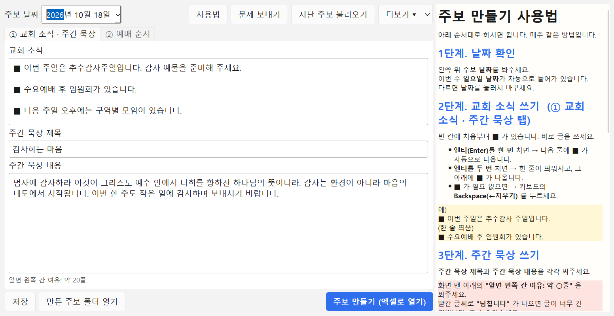
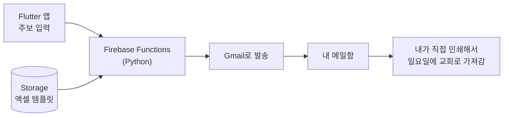
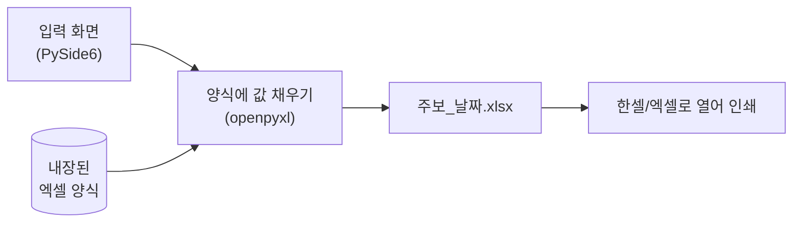
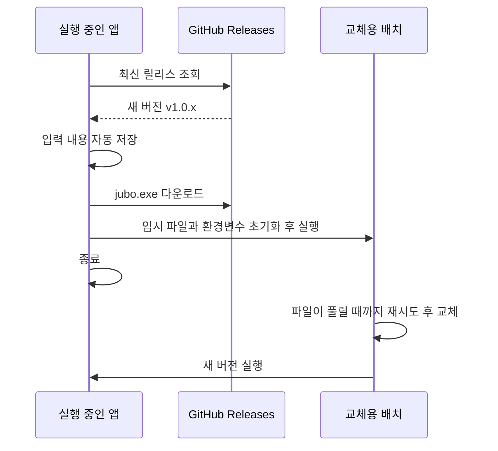

# 주보 만들기 (Church Bulletin Maker)

> 교회 주보를 입력하면 양식에 맞춰 엑셀로 만들어 바로 인쇄할 수 있는 **Windows 데스크톱 앱**.
> 서버·메일·설치 없이 `exe` 하나로 동작하고, 새 버전은 **스스로 업데이트**합니다.

| 입력 화면 | 예배 순서 | 사용법 패널 |
|---|---|---|
|  |  |  |

> 화면의 내용은 모두 가상의 예시입니다.

## 다운로드

**[⬇ 최신 버전 받기 (jubo.exe)](https://github.com/aproman-realman/jubo-releases/releases/latest/download/jubo.exe)**
· [릴리스 목록](https://github.com/aproman-realman/jubo-releases/releases)

- Windows 10 이상(64비트). 파이썬이나 다른 프로그램을 따로 설치할 필요가 없습니다.
- 주보 파일(`.xlsx`)을 열어 인쇄하려면 한셀 또는 엑셀이 필요합니다.
- 서명되지 않은 프로그램이라 처음 실행할 때 Windows 경고가 뜰 수 있습니다. **추가 정보 → 실행**을 누르세요.

## 만든 이유

담임목사님(장인어른)의 교회 주보를 편하게 만들려고 **v1**을 직접 만들어 쓰고 있었습니다.

문제는 **마지막 단계가 사람(나)에게 묶여 있다**는 점이었습니다. 내가 늦거나 못 가는 주에는 주보가 없어집니다.
정작 목사님 댁에도 노트북과 프린터가 있으니, 입력부터 인쇄까지 **그 자리에서 끝나게** 만들기로 했습니다.

## v2의 구조

서버, 메일, 로그인이 모두 사라졌고 인터넷이 없어도 주보를 만들 수 있습니다.

## 주요 기능

- **입력 항목은 매주 바뀌는 것만**: 교회 소식, 주간 묵상, 주일 오전·오후·수요 예배의 찬송·성경봉독·설교. 나머지는 양식에 고정합니다.
- **`■` 자동 입력**: 줄을 바꾸면 `■`가 자동으로 붙고, 엔터를 한 번 더 치면 한 줄이 띄워집니다. 특수문자를 찾을 필요가 없습니다.
- **넘침 감지**: 앞면 왼쪽 칸에 글이 얼마나 들어가는지 줄 수로 보여주고, 넘치면 경고합니다.
- **주차별 저장과 불러오기**: 지난 주보 내용을 가져와 고쳐 쓸 수 있습니다.
- **한눈에 보는 사용법**: 입력하면서 옆에서 볼 수 있도록 오른쪽 패널로 펼쳐집니다.
- **자동 업데이트**: 새 버전이 있으면 안내하고, 내려받아 교체한 뒤 다시 켭니다.
- **문제 보내기**: 오류가 나면 버튼 하나로 개발자에게 상황을 전송합니다.

## 설계 결정과 문제 해결

### 1. 서버를 걷어내기
v1의 병목은 기술이 아니라 **흐름**이었습니다. 메일과 사람을 거치는 대신, 만든 PC에서 바로 인쇄하도록 구조를 바꿨습니다.
Python 로직(`openpyxl`로 양식 채우기)은 그대로 재사용했습니다.

### 2. 인쇄 모양 문제 — 날짜가 잘리던 이유
v1에서는 주보 날짜가 오른쪽 정렬이라 인쇄할 때 잘려서, 매번 파일을 받아 가운데 정렬로 고쳐 인쇄했습니다.
병합 셀을 **가운데 정렬 + 셀에 맞춤(shrink to fit)** 으로 바꿔서 길이와 상관없이 잘리지 않게 했습니다.

### 3. 가변 영역 레이아웃
교회 소식이 길어지면 주간 묵상과 겹칩니다. 소식 영역은 글 길이에 맞춰 병합 범위를 다시 계산하고,
주간 묵상은 아래에서 위로 쌓습니다. 한 줄에 들어가는 글자 수를 추정해 화면에서 미리 **여유 줄 수**를 보여줍니다.

### 4. 앱에 비밀번호를 넣을 수 없다 — 오류 수집 방식
오류를 개발자 메일로 받으려면 보통 SMTP 비밀번호가 필요합니다. 하지만 **PyInstaller exe는 쉽게 풀어볼 수 있어서**
코드에 넣은 문자열은 그대로 노출됩니다. 그래서 비밀값이 필요 없는 **Google Forms 응답 주소**로 전송하고,
설문의 "새 응답 이메일 알림"으로 개발자 메일에 도착하게 했습니다. 앱에는 공개되어도 되는 값(설문 주소)만 들어 있습니다.

전송 내용은 **버전, 윈도우 정보, 입력 중이던 내용, 오류 기록 끝부분**이며, 사용자가 [보내기]를 눌렀을 때만 전송됩니다.

### 5. 자동 업데이트 (GitHub Releases)
현장에 다시 찾아가지 않고도 고칠 수 있어야 했습니다. 공개 저장소의 최신 릴리스를 조회해서 새 버전이 있으면 안내합니다.

**겪은 문제: 업데이트 후 `Failed to load Python DLL`.**
PyInstaller 단일 exe는 압축을 푼 임시 폴더(`_MEI…`)의 위치를 환경변수(`_PYI_*`)로 자식 프로세스에 물려줍니다.
업데이트 후 새 exe를 띄우면 이 값이 따라가는데, 옛 임시 폴더는 이미 지워진 뒤라 DLL을 찾지 못했습니다.
`_PYI_*` 환경변수를 지우고 `PYINSTALLER_RESET_ENVIRONMENT=1`을 주는 것으로 해결했고(v1.0.2),
일반 파이썬이 아닌 **진짜 PyInstaller exe**로 재현하고 전체 흐름을 다시 검증했습니다.

### 6. 오류 기록
오류는 `문서\주보\오류기록\오류기록.txt`에 자동으로 남고(회전 로그), 처리되지 않은 예외도 안내창과 함께 기록됩니다.
오류 재현에 필요한 **그 순간의 입력 데이터**도 함께 남깁니다.

## 기술 스택

| 영역 | 사용 |
|---|---|
| 언어 | Python 3.14 |
| 화면 | PySide6 (Qt) |
| 엑셀 | openpyxl (양식 채우기, 이미지 보존) |
| 패키징 | PyInstaller (`--onefile`, 약 55MB) |
| 배포·업데이트 | GitHub Releases (공개 API, 인증 없음) |
| 오류 수집 | Google Forms 응답 주소 + 이메일 알림 |

## 버전 이력

| 버전 | 내용 |
|---|---|
| v1.0.3 | 교회 소식 첫 줄의 `■` 보호, 뒷면 '쪽 가운데 배치(가로)' 해제, **뒷면 양식 개선본 적용**(열 삽입·간격 조정), 한셀에서 저장한 파일도 양식으로 사용 가능 |
| v1.0.2 | 업데이트 후 재실행 오류(`Failed to load Python DLL`) 수정 |
| v1.0.1 | 사용법을 팝업에서 옆 패널로 변경, **문제 보내기** 추가, 메뉴 정리 |
| v1.0.0 | 첫 배포: 입력 → 엑셀 생성, `■` 자동 입력, 넘침 감지, 자동 업데이트, 오류 기록 |

## 만든 방법

기획과 요구사항 정리, 현장 테스트와 피드백은 직접 하고, 설계와 구현은 [Claude Code](https://claude.com/claude-code)와 함께 진행했습니다.
이 저장소는 **배포용**이라 실행 파일과 문서만 있습니다.
